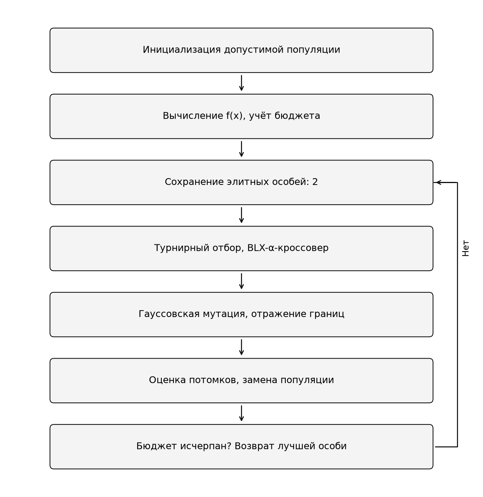
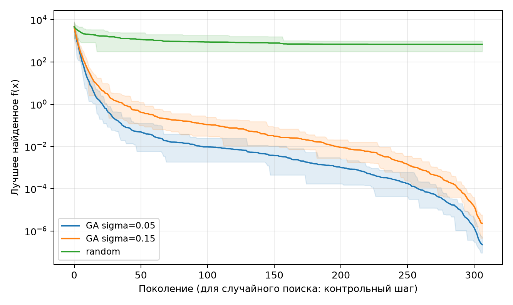
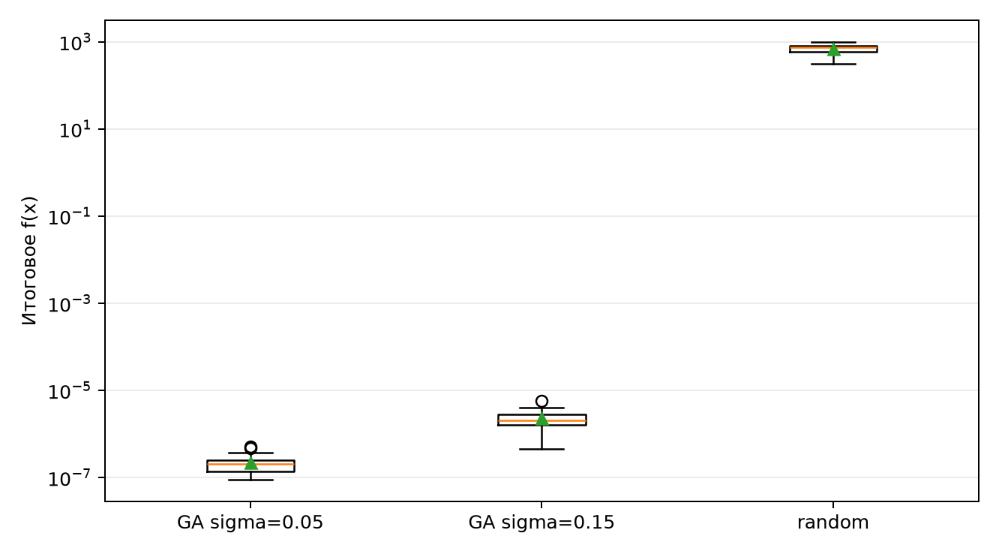

# Лабораторная работа № 1

## Многомерная оптимизация генетическим алгоритмом

### 1. Постановка задачи

N = 11, группа 517, Q = 1, Y = 26. V = 1 + ((17·11 + 7·1 + 26) mod 20) = 1. Размерность d = 5 + (V mod 6) = 6. Требуется минимизировать функцию «Сфера» на области [-100; 100]^6.

`f(x) = sum(x_i^2)`.

Теоретический ориентир: f* = 0. Каждое слагаемое неотрицательно, а при x = (0, 0, 0, 0, 0, 0) сумма равна нулю; следовательно, глобальный минимум равен нулю.

### 2. Представление и алгоритм

Генотип и фенотип совпадают: особь представляет собой вещественный вектор длины d. Начальная популяция равномерно распределена в допустимой области. Селекция проводится турниром из 3 особей. BLX-α-кроссовер выбирает каждый ген равномерно на интервале [min(a,b) - α|a-b|; max(a,b) + α|a-b|], α = 0.3. Его вероятность равна 0.9. При отсутствии кроссовера копируется первый родитель.

Каждый ген мутирует независимо с вероятностью 1/d. Добавляется нормальная случайная величина с нулевым средним и стандартным отклонением σ(g)(u-l), где σ(g) = σ₀[0.0001 + 0.9999(1-E/B)²], E - уже использованный бюджет, B - полный бюджет. Убывание масштаба задано заранее и одинаково в обеих конфигурациях. Выход за границы устраняется повторным отражением. Число переносимых элитных особей: 2; их оценки повторно не вычисляются. Остановка наступает при точном исчерпании бюджета. Последний пакет потомков при необходимости неполный; оставшиеся позиции заполняются ранее оценёнными неэлитными родителями без новых вычислений функции. Размер популяции сохраняется равным 100.

Турнир не требует масштабирования функции. BLX-α выбирает значения между родителями, а при α > 0 также допускает выход за родительский интервал. Мутация восстанавливает разнообразие, отражение сохраняет допустимость, а элитизм гарантирует невозрастание лучшего значения.

### 3. Методика эксперимента

| Параметр | Значение |
| --- | --- |
| Число независимых запусков каждого метода | 20 |
| Начальные seed | 1000–1019 |
| Вычислений функции на запуск | 30000 |
| Размер популяции / число элит | 100 / 2 |
| Размер турнира / вероятность кроссовера | 3 / 0.9 |
| Параметр BLX-α | 0.3 |
| Вероятность мутации одного гена | 1/d = 0.166667 |
| Сравниваемый фактор | Начальный масштаб σ₀: 0.05 и 0.15 |
| Условие практического успеха | f(x) - f* ≤ 1e-06 |

Сравниваются две конфигурации ГА, различающиеся только σ₀, и равномерная случайная выборка. Во всех методах учитывается одно вычисление на каждый оценённый вектор, включая начальную популяцию. Используются парные seed; первые 100 точек одинаковы у всех методов. Это сохраняет независимость запусков с различными seed и уменьшает влияние различий старта. Нулевой вектор специально не добавляется. Для случайного поиска контрольные шаги совпадают по числу оценок с поколениями ГА. Стандартное отклонение рассчитано с делителем n - 1; для единственного запуска в машиночитаемых файлах сохраняется 0 как условное значение, не оценка разброса. Время измеряется отдельно и зависит от среды выполнения.

### 4. Результаты

| Метод | Лучшее | Среднее | Медиана | Ст. откл. | Худшее |
| --- | --- | --- | --- | --- | --- |
| GA sigma=0.05 | 9.11132e-08 | 2.24373e-07 | 2.08177e-07 | 1.15667e-07 | 5.1855e-07 |
| GA sigma=0.15 | 4.52894e-07 | 2.29127e-06 | 2.09196e-06 | 1.18798e-06 | 5.71746e-06 |
| random | 308.449 | 676.548 | 731.871 | 195.392 | 978.61 |

Наименьшее среднее среди ГА получено для GA sigma=0.05: 2.24373e-07. Отношение среднего результата случайного поиска к этому значению равно 3.02e+09. Во всех запусках израсходовано ровно 30000 оценок. Все итоговые решения допустимы.

Доля достижения заданной точности: GA sigma=0.05 - 100%; GA sigma=0.15 - 10%; случайный поиск - 0%. Среднее время запуска составило соответственно 0.0235, 0.0234 и 0.0024 с.

Линии показывают среднее лучшее значение, полупрозрачная область - минимум и максимум по серии. Логарифмическая шкала позволяет сопоставить порядок ошибки. Для случайного поиска показан лучший результат накопленной выборки.

Лучшее решение получено методом GA sigma=0.05, seed = 1014, f(x) = 9.111321541e-08. Его координаты:

`[-0.000100454203, 3.46246801e-05, -0.000194242818, -0.000176315927, 3.90214022e-05, -9.73809625e-05]`.

Все координаты с полной точностью, индивидуальные результаты и траектории представлены в results/solutions.json, results/runs.csv и results/histories.csv.

### 5. Анализ и вывод

Функция выпукла и не затрудняет градиентный поиск. Трудность случайного поиска связана с малой относительной мерой окрестности минимума при росте размерности. На выбранной функции первый начальный масштаб мутации улучшил среднее итоговое значение по сравнению со вторым масштабом. Отношение средних результатов второго ГА к первому равно 10.2. Это наблюдение относится к указанному бюджету, представлению и серии seed; оно не устанавливает универсальное преимущество параметра.

Результат GA sigma=0.05 является хорошим для данной задачи: точность 1e-06 достигнута во всех 20 запусках, а значения сопоставлены с доказанным минимумом. Для GA sigma=0.05 точность достигнута в 20 из 20 запусков; для GA sigma=0.15 - в 2 из 20 запусков. Сфера является простой унимодальной функцией, поэтому эксперимент не доказывает эффективности ГА на мультимодальных задачах. Для сферы градиентные или аналитические методы экономичнее. Дополнительное требование выполнено реализацией BLX-α-кроссовера. Дальнейшее исследование может включать чувствительность к размеру популяции и сравнение с методами, использующими производные.

### Источник

Душкин Р. В. Эволюционное программирование и генетические алгоритмы: комплекс лабораторных работ. Общие требования, лабораторная работа № 1, приложение с формулами. С. 1–8, 25–31.
