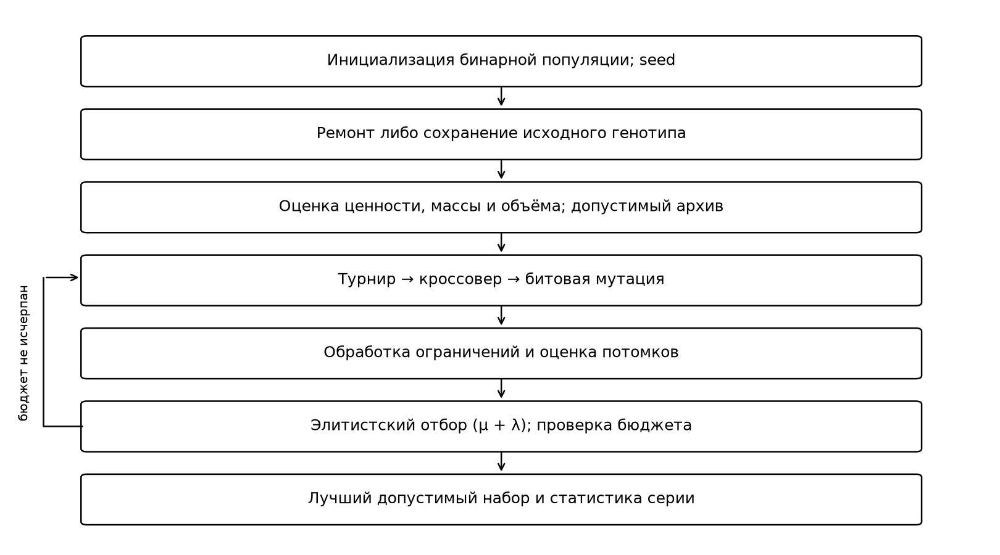
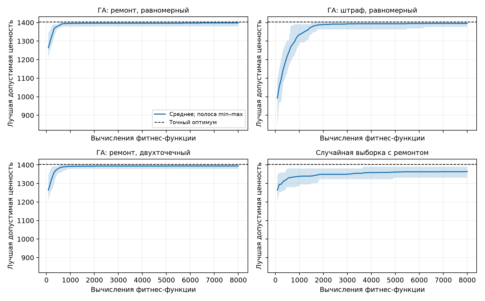
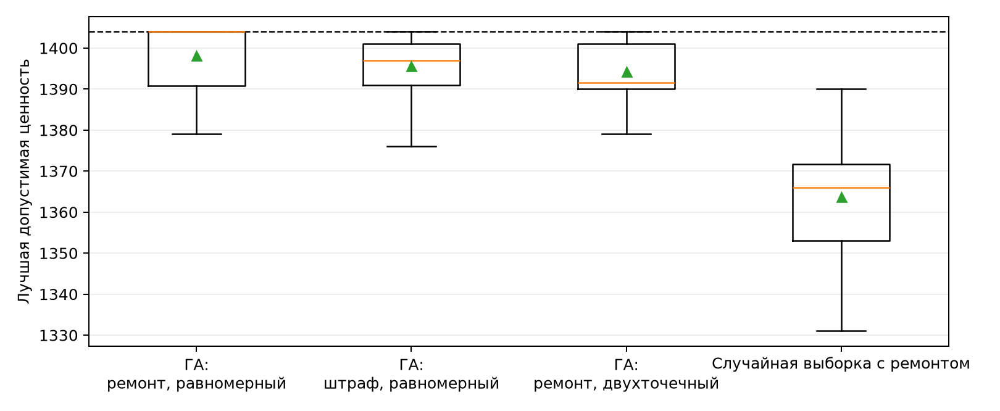

# Лабораторная работа № 2

## 1. Постановка задачи

Дисциплина: «Эволюционное программирование и генетические алгоритмы». Индивидуальные параметры: N = 11, группа 517, Q = 1, Y = 26. Вариант V = 1 + ((17·11 + 7·1 + 26) mod 20) = 1. Рассматривается рюкзак с ограничениями массы и объёма.

Имеются 40 неделимых предметов. Генотип x принадлежит {0,1}^40; x_i = 1 означает включение предмета i. Фенотипом является выбранное множество предметов, дополнительное декодирование не требуется. Цель: максимизировать F(x) = Σ c_i x_i при ограничениях Σ m_i x_i ≤ 200 и Σ v_i x_i ≤ 170. Масса, объём и ценность заданы в условных целочисленных единицах. Все ограничения жёсткие; штраф применяется только как механизм поиска.

Данные соответствуют генератору NumPy PCG64 при seed = 210026: последовательно получены 40 масс из целых [3,22], 40 объёмов из [2,18] и 40 ценностей из [12,110] равномерным выбором. Таблица: `data/items.csv`. Контрольная сумма и сведения о загрузке сохранены в `results/input_data.json`. Экземпляр служит для сравнения методов, а не для моделирования конкретного склада.

## 2. Алгоритм и параметры

Использован собственный генетический алгоритм (μ + λ). Размеры родительской популяции и поколения потомков равны 80. Инициализация: 79 независимых бинарных строк с вероятностью единицы 0,5 и пустой допустимый набор. Турнир состоит из 3 кандидатов с выборкой с возвращением. Вероятность кроссовера равна 0.9; вероятность инверсии каждого бита равна 0.025. После оценки потомков сохраняются 80 лучших особей из родителей и потомков; значения фитнеса родителей повторно не вычисляются. Отдельный архив сохраняет лучший допустимый набор.

Реализованы два способа обработки ограничений. Ремонт удаляет включённые предметы по возрастанию c_i/(m_i/200 + v_i/170), пока оба ограничения не выполнены. Допустимые строки остаются неизменными. Удаление не нарушает бинарность, а пустое множество всегда допустимо, поэтому процедура завершается. Штрафной способ сохраняет генотип и максимизирует S(x) = F(x) - 10·[max(0,M(x)-200) + max(0,V(x)-170)]. Величина S не подменяет исходную ценность F; качество всех методов измеряется по допустимому архиву.

Равномерный кроссовер выбирает каждый бит из одного из двух родителей с вероятностью 0,5. Двухточечный кроссовер переносит непрерывный сегмент второго родителя в копию первого. Оба оператора сохраняют алфавит {0,1}, но могут нарушать ресурсные ограничения; после них применяется выбранный способ обработки ограничений. Битовая мутация соответствует неделимому выбору предметов. Порядок строк не вводит дополнительных ограничений модели; равномерный кроссовер наследует выбор каждого предмета независимо от соседних индексов.

## 3. Методика эксперимента

Для каждой из 4 конфигураций проведено 20 независимых запусков с seed: 2000, 2001, 2002, 2003, 2004, 2005, 2006, 2007, 2008, 2009, 2010, 2011, 2012, 2013, 2014, 2015, 2016, 2017, 2018, 2019. Внутри серии seed различаются; между методами используются одинаковые номера seed для сопоставления. Бюджет каждого запуска равен 8000 вычислениям фитнес-функции: 80 исходных особей и 99 поколений по 80 потомков. Ремонт использует исходную таблицу ценностей и текущие суммы ресурсов; дополнительных оценок полной целевой функции при ремонте нет. Каждая подготовленная строка оценивается один раз, включая повторяющиеся строки. Лимит относится к поиску; отдельный точный эталон в него не включён.

Сравнение «ГА: ремонт, равномерный» и «ГА: штраф, равномерный» меняет только способ обработки ограничений. Сравнение «ГА: ремонт, равномерный» и «ГА: ремонт, двухточечный» меняет только оператор кроссовера. «Случайная выборка с ремонтом» независимо генерирует строки с вероятностью единицы 0,5, применяет ремонт и сохраняет допустимый архив; её начальный пакет содержит пустой набор. Отбор родителей отсутствует, бюджет равен 8000 оценкам.

Точный эталон получен собственной динамической программой по двум целочисленным ресурсам: D_i(a,b) = max(D_(i-1)(a,b), c_i + D_(i-1)(a-m_i,b-v_i)) для допустимых индексов; начальное D_0(a,b) = 0. Сложность O(n·200·170). Обратный проход восстанавливает набор. Получено F* = 1404; масса 200, объём 169. Рекуррентный перебор альтернатив «взять/не взять» даёт точную гарантию для предоставленного экземпляра и не является основным оптимизатором.

## 4. Проверка допустимости

| Пример | Масса | Объём | Ценность | Превышение массы | Превышение объёма | Допустим |
|---|---:|---:|---:|---:|---:|---|
| empty_feasible | 0 | 0 | 0 | 0 | 0 | да |
| optimal_feasible | 200 | 169 | 1404 | 0 | 0 | да |
| mass_only | 207 | 168 | 938 | 7 | 0 | нет |
| volume_only | 194 | 183 | 901 | 0 | 13 | нет |

Полные бинарные векторы и идентификаторы предметов приведены в `results/examples.json`. Первые два примера допустимы; третий и четвёртый нарушают ограничения, как показано в таблице. При взаимозависимых ресурсных ограничениях изолированное нарушение каждого ресурса может быть невозможно. После поиска ценность и оба ресурса каждого архивного решения повторно вычислены из исходной таблицы независимо от поискового счётчика.

## 5. Результаты

В таблице приведена лучшая допустимая ценность каждого запуска. Стандартное отклонение выборочное, с делителем n - 1.

| Метод | Лучшее | Среднее | Медиана | Станд. откл. | Худшее |
|---|---:|---:|---:|---:|---:|
| ГА: ремонт, равномерный | 1404 | 1398.15 | 1404.0 | 7.62 | 1379 |
| ГА: штраф, равномерный | 1404 | 1395.60 | 1397.0 | 8.03 | 1376 |
| ГА: ремонт, двухточечный | 1404 | 1394.30 | 1391.5 | 6.87 | 1379 |
| Случайная выборка с ремонтом | 1390 | 1363.65 | 1366.0 | 13.78 | 1331 |

| Метод | Допустимые оценки, % | Допустимый лидер, % | Достижение F*, % | Средний разрыв, % | Время, с |
|---|---:|---:|---:|---:|---:|
| ГА: ремонт, равномерный | 100.0 | 100 | 55 | 0.42 | 0.187 |
| ГА: штраф, равномерный | 44.4 | 45 | 25 | 0.60 | 0.103 |
| ГА: ремонт, двухточечный | 100.0 | 100 | 25 | 0.69 | 0.213 |
| Случайная выборка с ремонтом | 100.0 | 100 | 0 | 2.87 | 0.098 |

Доля допустимых оценок рассчитана по всем 8000 обработанным кандидатам. Допустимый лидер означает допустимость особи с максимальным поисковым score в конечной популяции; допустимый архив при этом существует во всех запусках. Разрыв равен 100·(F* - F)/F*. Время усреднено по серии и включает поиск с ремонтом, но исключает генерацию данных, точный эталон, построение графиков и повторную проверку архива. Число оценок во всех запусках проверено программно.

Лучший найденный допустимый набор получен методом `repair_uniform`, seed = 2003: I01, I04, I06, I07, I10, I12, I13, I16, I20, I21, I22, I24, I28, I31, I34, I35, I40. Ценность равна 1404, масса 200 ≤ 200, объём 169 ≤ 170. Полная предметная таблица выбранного набора сохранена в `results/best_set.csv`, вектор и проверенные суммы - в `results/best_solution.json`.

## 6. Анализ и вывод

Для «ГА: ремонт, равномерный» и «ГА: штраф, равномерный» средние равны 1398.15 и 1395.60; разность второго и первого составляет -2.55. Для «ГА: ремонт, равномерный» и «ГА: ремонт, двухточечный» средние равны 1398.15 и 1394.30; разность второго и первого составляет -3.85. Это наблюдения на одной серии и одном экземпляре, а не доказательство универсального превосходства оператора.

Среднее «Случайная выборка с ремонтом» составляет 1363.65; преимущество «ГА: ремонт, равномерный» по средней допустимой ценности равно +34.50. Точный эталон позволяет оценивать качество по измеримому разрыву, а не по субъективной близости результатов. Лучший результат имеет разрыв 0.00%; распределения и частота достижения F* характеризуют воспроизводимость качества. При нулевом F* и нулевой допустимой ценности относительный разрыв принимается равным нулю.

Ограничения исследования: один экземпляр; фиксированные коэффициент штрафа и вероятности операторов; условные единицы ресурсов; восстановление допустимости может смещать поиск к предметам высокой плотности. При увеличении задачи двухресурсная динамическая программа становится дорогой. Дальнейшее исследование требует нескольких экземпляров, анализа коэффициента штрафа и альтернативных процедур ремонта. Строгая гарантия относится к DP-эталону; результаты ГА являются экспериментальными.

## 7. Воспроизводимость

Реализация проверена с Python 3.13.14 и NumPy 2.5.4. Фактические параметры находятся в `results/config_snapshot.json`; результаты отдельных запусков - в `results/runs.csv`, траектории - в `results/convergence.csv`, сводка - в `results/summary.csv`. Для повторения используются эта конфигурация и входная таблица `data/items.csv` через параметры --config и --data. Инструкция установки и команды запуска приведены в README.

Источник постановки: Душкин Р. В. «Эволюционное программирование и генетические алгоритмы. Комплекс лабораторных работ», лабораторная работа № 2, вариант 1.
