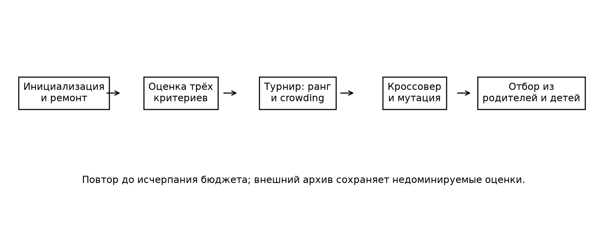
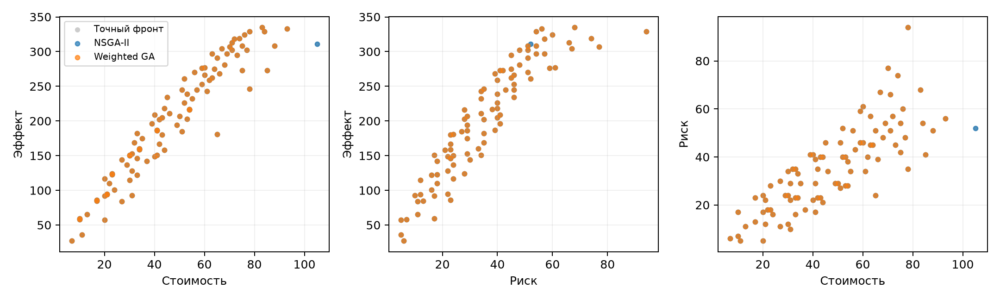
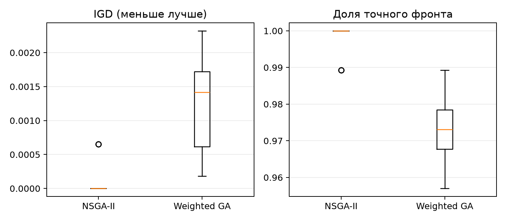

# Лабораторная работа № 3

## 1. Постановка задачи

Вариант 1, трек A: многокритериальный подбор портфеля проектов. N = 11, группа 517, Q = 1, Y = 26. V = 1 + ((17·11 + 7·1 + 26) mod 20) = 1. Правило распределения треков в задании отсутствует; выбран трек A.

Выбирается непустое подмножество из 16 проектов. Критерии: максимум суммарного эффекта E, минимум стоимости C и ожидаемых потерь R. Стоимость, эффект и риск измеряются в условных единицах; трудоёмкость - в человеко-днях. Аддитивность и отсутствие синергии являются допущениями модели.

## 2. Модель и данные

Генотип x ∈ {0,1}^16 совпадает с фенотипом выбранного множества. Минимизируется вектор F(x) = (-Σeᵢxᵢ, Σcᵢxᵢ, Σrᵢxᵢ). Ограничения: Σcᵢxᵢ ≤ 105; Σsᵢxᵢ ≤ 43; Σxᵢ ≥ 1. Зависимости в нумерации проектов с 1: 10 требует 3; 13 требует 6; 16 требует 4.

Таблица совпадает с синтетическими данными NumPy default_rng при seed = 110517. Для каждого проекта последовательно генерируются целочисленные стоимость U[7,25], эффект U[15,69], риск U[2,27], трудоёмкость U[3,12]. Источник и SHA-256 таблицы сохранены в results/data_manifest.json. Проекты упорядочены по уникальным ID 1…n. Ремонт удаляет проекты с невыполненными зависимостями и случайные выбранные проекты при перегрузке; пустой портфель заменяется допустимым непустым набором. При ремонте проверяются ресурсы; полный вектор F не вычисляется.

## 3. Алгоритмы и параметры

Реализован NSGA-II: строгая недоминируемая сортировка, турнир по рангу и расстоянию до скопления, равномерный бинарный кроссовер, побитовая мутация и элитистский отбор из объединения родителей и потомков. Инициализация: каждый бит независимо равен единице с вероятностью 0.35, затем применяется ремонт. Турнир включает два кандидата с возвращением. Расстояние до скопления нормируется по каждому непостоянному критерию; граничные точки сохраняются преимущественно. Равномерный кроссовер независимо наследует каждый бинарный выбор; побитовая мутация меняет включение отдельного проекта, а ремонт восстанавливает зависимости.

Размер популяции 80; вероятность кроссовера 0.9; вероятность мутации каждого бита 0.0625. Бюджет 12000 оценок вектора F на запуск, включая начальную популяцию и повторные генотипы. Остановка строго по бюджету. Выполнено 20 независимых запусков с seed 300–319 для каждого метода.

Базовый метод объединяет 5 скалярных ГА со взвешенными суммами нормированных критериев и теми же операторами. Веса: (0.8,0.1,0.1), (0.1,0.8,0.1), (0.1,0.1,0.8), (0.34,0.33,0.33), (0.5,0.25,0.25). Общий бюджет делится между весами с разницей не более одной оценки; все начальные популяции входят в бюджет. Нормирование - на суммы коэффициентов критериев по всем проектам; для тождественно нулевого критерия знаменатель равен единице. У обоих методов сохраняется внешний архив всех недоминируемых оценённых решений; проверка доминирования не требует нового вычисления F. Новый механизм относительно работ № 1–2 - сортировка по Парето и поддержание разнообразия по crowding distance.

## 4. Методика оценки

Полным перебором 2^16 = 65536 генотипов получено 4659 допустимых портфелей и 93 различных векторов точного фронта. Перебор служит независимым эталоном, не участвует в инициализации или поиске; его затраты исключены из равных поисковых бюджетов. Бюджет измеряет число полных векторов F; ресурсные проверки учитываются во времени. Для данного малого экземпляра точный метод практически применим; при росте числа проектов его стоимость экспоненциальна.

IGD - среднее по точному фронту расстояние до ближайшей найденной точки в нормированных критериях. Аддитивный ε-индикатор равен max по эталонным точкам минимума по найденным точкам максимального покоординатного превышения; меньшее значение лучше. Покрытие - доля точных векторов, присутствующих в архиве; точность - доля архива, принадлежащая точному фронту. Недоминируемость внутри выборки сама по себе не доказывает принадлежность точному фронту.

## 5. Результаты

| Метод | Лучший IGD | Средний | Медиана | s | Худший | Среднее покрытие | Средний ε |
|---|---:|---:|---:|---:|---:|---:|---:|
| NSGA-II | 0.00000 | 0.00013 | 0.00000 | 0.00027 | 0.00065 | 0.998 | 0.00086 |
| Weighted GA | 0.00018 | 0.00120 | 0.00142 | 0.00069 | 0.00232 | 0.973 | 0.00669 |

s - выборочное стандартное отклонение. Значения каждого запуска, время и число оценок приведены в results/runs.csv; статистики остальных показателей - в results/summary.json. Все сохранённые портфели проходят проверку допустимости.

На проекциях показаны архивы первого запуска обоих методов, seed = 300. Проекция может скрывать различия по третьему критерию; доминирование проверяется в трёхмерном пространстве.

Характерные решения из архива NSGA-II первого запуска (3):

| Тип | Проекты | Эффект | Стоимость | Риск |
|---|---|---:|---:|---:|
| Экономичный | 11 | 27 | 7 | 6 |
| Сбалансированный | 1, 2, 5, 6 | 211 | 46 | 34 |
| Максимальный эффект | 1, 3, 4, 5, 6, 10 | 335 | 83 | 68 |

Экономичный портфель минимизирует затраты, максимальный эффект ориентирован на суммарный результат проектов. Сбалансированное решение минимизирует нормированное евклидово расстояние до идеальной точки внутри найденного архива; это явно заданное предпочтение, а не универсальный оптимум.

## 6. Выводы

Средний IGD NSGA-II меньше, чем у объединения взвешенных ГА; средние покрытия составили 99.8% и 97.3%. Сравниваются совокупные конфигурации: NSGA-II использует один поиск, а взвешенный метод делит бюджет между 5 поисками. Поэтому наблюдаемую разницу нельзя приписать только способу отбора. Веса задают направления поиска; Парето-ранжирование с расстоянием до скопления поддерживает разнообразие без предварительного задания предпочтений.

Для данного экземпляра результат NSGA-II является хорошим: среднее покрытие точного фронта составляет 99.8% при IGD 0.000130259. Оценка опирается на известное множество компромиссов, а не на один экстремальный портфель. Результат является приближением полного множества компромиссов; принадлежность отдельных найденных векторов эталону проверяется перебором. Обобщение на реальные проекты ограничено аддитивной моделью, единственным экземпляром и фиксированным набором весов. Возможные улучшения: больше экземпляров, нелинейные взаимодействия и анализ чувствительности к ограничению бюджета.

Источник постановки: Р. В. Душкин. «Эволюционное программирование и генетические алгоритмы», комплекс лабораторных работ, с. 12–15; исходный PDF в корне проекта.
