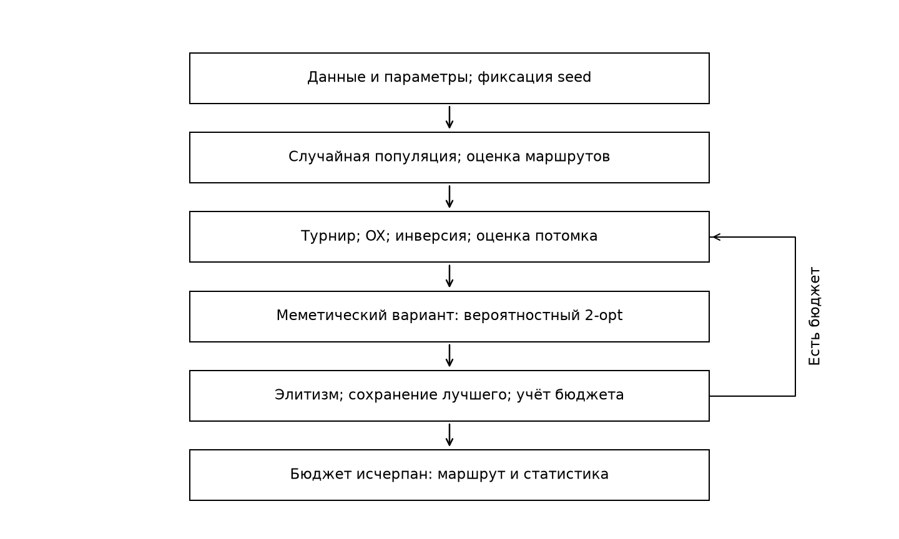
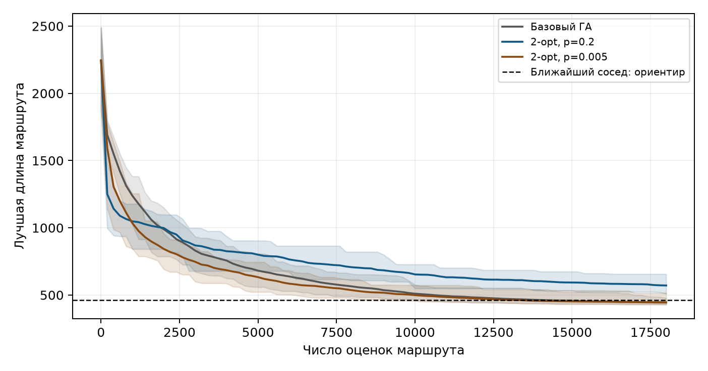
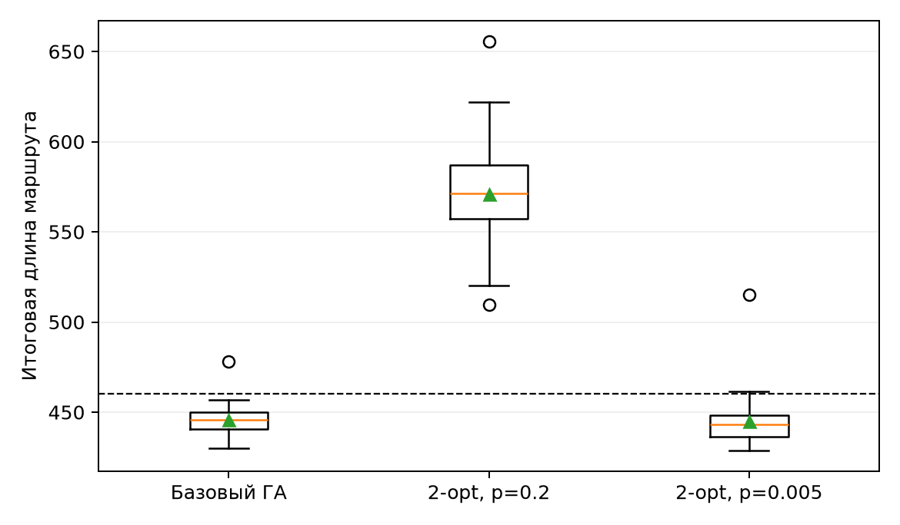
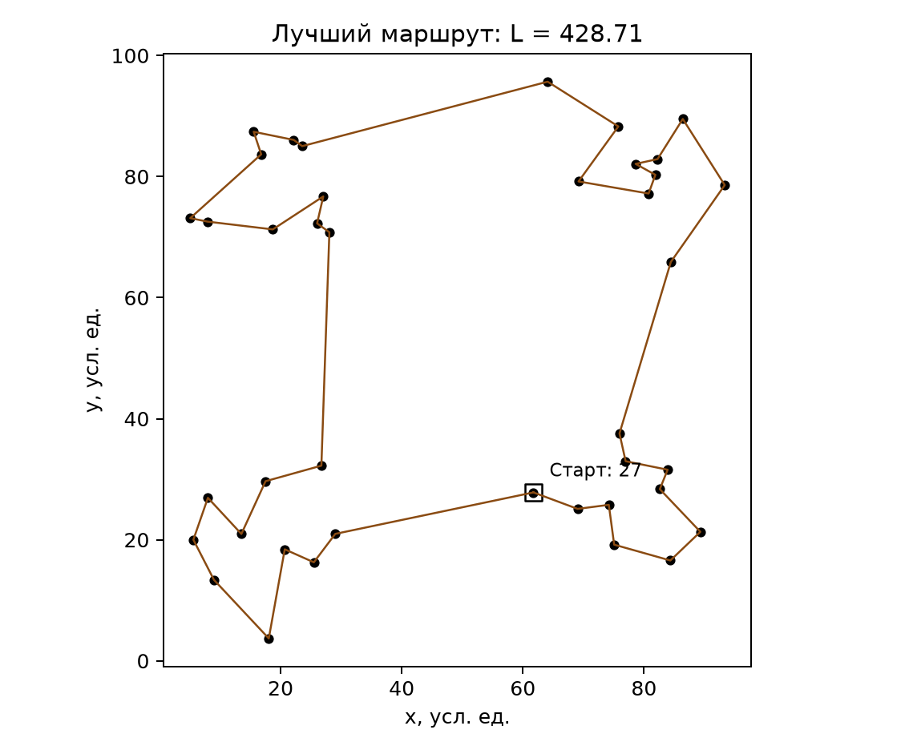

# Лабораторная работа № 4

## Меметический алгоритм решения задачи маршрутизации

### 1. Постановка задачи

Индивидуальные параметры: N = 11, группа 517, Q = 1, Y = 26. Вариант V = 1 + ((17·11 + 7·1 + 26) mod 20) = 1. Тема 1: генетический алгоритм с локальным поиском 2-opt. Предварительная постановка зафиксирована в PROPOSAL.md.

Требуется построить замкнутый маршрут обслуживания 40 пунктов. Генотип π является перестановкой множества {0, …, 39}; фенотип - последовательность посещения пунктов с возвратом в начало. Минимизируется L(π) = Σ d(π[k], π[(k+1) mod 40]), k = 0, …, 39, где d - евклидово расстояние. Ограничение: каждый пункт посещается ровно один раз. Единицы координат и расстояний условные. Вместимость, дорожная сеть и временные окна не моделируются.

Данные синтетические: NumPy default_rng, seed 20261104; четыре центра (20,20), (20,80), (80,20), (80,80); числа точек [10, 10, 10, 10]. Координаты независимы, нормальное распределение со стандартным отклонением 8. Таблица: data.csv. Происхождение проверено повторной генерацией.

### 2. Алгоритмы и эксперимент

Начальная популяция состоит из независимых равномерных случайных перестановок. Базовый ГА использует турнирную селекцию, OX-кроссовер, инверсию и элитизм. OX сохраняет порядок части родительского маршрута; инверсия меняет последовательность посещения сегмента. Оба оператора сохраняют перестановку, поэтому ремонт ограничений не требуется.

Меметический вариант дополнительно применяет к потомку ограниченный 2-opt: перебирает в случайном порядке до 120 пар несмежных рёбер и принимает каждое строгое улучшение. Полный локальный оптимум не гарантируется. После каждого принятия дальнейшие пары применяются к обновлённому маршруту.

| Параметр | Значение |
| --- | --- |
| Популяция; элита; размер турнира | 80; 2; 3 |
| Вероятность OX; вероятность инверсии | 0.9; 0.3 |
| Вероятности 2-opt; предел проверок | 0.2 и 0.005; 120 |
| Бюджет каждого запуска | 18000 оценок маршрута |
| Независимые запуски каждого метода | 30 |
| Seed алгоритма | 4000 … 4029 |

Остановка происходит точно при исчерпании бюджета. Одна оценка - полный расчёт длины одного маршрута. Учтены начальная популяция, потомки и все проверенные соседи 2-opt; копирование элиты не требует повторной оценки. При неполном последнем поколении сохраняется лучший из всех оценённых маршрутов. Число поколений методов различается. Бюджет и остальные параметры совпадают; различается наличие либо частота 2-opt. Одинаковые номера seed используются попарно; после включения локального поиска последовательности случайных обращений расходятся.

Исследуются частоты 0.2 и 0.005. Редкая конфигурация добавлена разведочно после первоначального отрицательного результата. Три пробных запуска при seed 4000 (частоты 0,005; 0,01; 0,02) записаны в results/pilot.csv и учтены отдельно от основных сравнений. Дополнительное сравнение не представляет независимого подтверждения выбранной настройки.

### 3. Результаты

Полные результаты содержатся в results/runs.csv; траектории - в results/traces.csv. В таблице приведено выборочное стандартное отклонение с делителем n-1. Все полученные маршруты допустимы.

| Метод | Лучшее | Среднее | Медиана | Ст. откл. | Худшее |
| --- | --- | --- | --- | --- | --- |
| Базовый ГА | 430.026 | 445.590 | 445.708 | 9.008 | 478.003 |
| ГА + 2-opt | 509.419 | 571.011 | 571.259 | 32.285 | 655.701 |
| ГА + редкий 2-opt | 428.711 | 444.794 | 443.366 | 15.771 | 515.056 |

Среднее время запуска: базовый ГА 0.394 с; ГА + 2-opt 0.179 с. Время является характеристикой данного запуска и окружения. Среднее число оценок, использованных локальным поиском: 17205.933; эти оценки входят в общий лимит 18000.

Для редкого 2-opt среднее время составляет 0.312 с, среднее число локальных оценок 6647.100. Все три конфигурации имеют одинаковый общий бюджет.

Линии обозначают средние лучшие найденные значения, области - минимум и максимум по независимым запускам. Они отражают разброс, а не доверительный интервал. Итоговое распределение показано ниже.

Частый локальный поиск 2-opt увеличил среднюю длину на 28.15%. В 0 из 30 пар seed этот вариант получил более короткий маршрут. Это описательное сравнение на одном экземпляре, а не доказательство превосходства на всех задачах маршрутизации.

Редкий 2-opt изменил среднюю длину относительно базового ГА на -0.18% и выиграл в 19 из 30 пар seed. Сопоставление двух частот показывает цену локального улучшения при фиксированном числе полных оценок.

### 4. Предметная интерпретация и оценка качества

Лучший маршрут получен конфигурацией memetic_sparse при seed 4024, его длина 428.711. Порядок посещения и длины участков приведены в results/best_route.csv; последнее ребро возвращает маршрут в начало.

Конструктивный ориентир - лучший маршрут ближайшего соседа по всем 40 стартовым пунктам: 460.408. Он построен отдельно и не включён в сравнение равных бюджетов. Минимальное остовное дерево даёт строгую нижнюю границу 354.719: удаление любого ребра гамильтонова цикла оставляет остовное дерево. Отклонение лучшего результата от этой границы составляет 20.86%; изменение относительно ближайшего соседа составляет -6.88%. Разрыв с нижней границей не равен фактической ошибке относительно неизвестного оптимума.

### 5. Выводы и ограничения

Частый 2-opt увеличил среднюю длину на 28.15%. При частоте 0.005 изменение составило -0.18%, стандартное отклонение выросло: 9.008 и 15.771. При равном бюджете локальный поиск сокращает число поколений, поэтому его интенсивность необходимо согласовывать с затратами эволюционного поиска. Разведочно выбранная редкая конфигурация требует независимой проверки.

Лучший маршрут допустим и не длиннее конструктивного ориентира. Глобальная оптимальность не доказана. Выводы ограничены одним входным экземпляром. Дальнейшая работа: несколько размеров и наборов координат, настройка локального бюджета, контроль разнообразия и ограничения реальной доставки. Сценарий демонстрации на 6 минут приведён в DEMO.md.

Источник задания: Душкин Р. В. «Эволюционное программирование и генетические алгоритмы. Комплекс лабораторных работ», раздел лабораторной работы № 4, с. 18-20.
